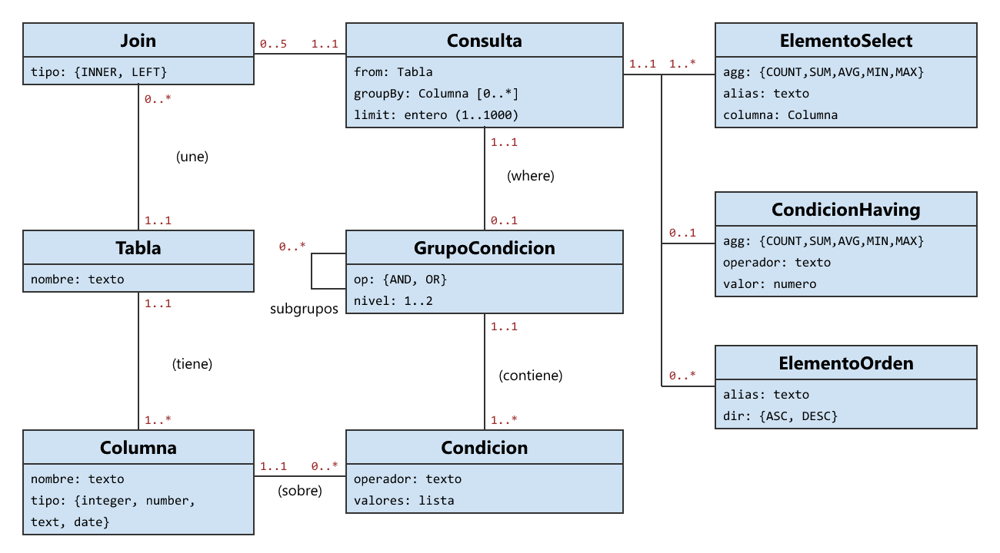
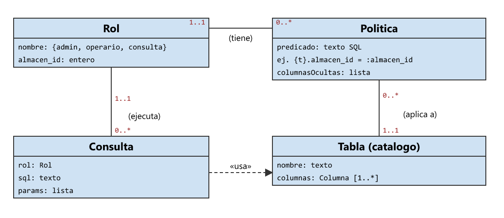

# 4. Metamodelo del DSL

Sintaxis abstracta = AST de la consulta (JSON). Sintaxis concreta = AST JSON (lo que arma la interfaz) + SQL parametrizado (lo que genera el compilador).



Roles y políticas: 

## 4.1 Metaclases
| Metaclase | Descripción | Restricciones |
|---|---|---|
| Consulta | Raíz del AST. | `limit` 1..1000; ≥ 1 ElementoSelect; solo claves conocidas. |
| Tabla (catálogo) | Tabla autorizada por la whitelist. | Efectiva por rol (catálogo − columnas ocultas). |
| Columna | Columna de una tabla. | `tipo` ∈ {integer, number, text, date}. |
| Relacion | FK permitida para JOIN. | El cliente no escribe el `ON`. |
| Join | Tabla adicional. | `tipo` ∈ {INNER, LEFT}; máx. 5; requiere Relacion con tabla ya incluida. |
| ElementoSelect | Campo proyectado. | `agg` ∈ {COUNT, SUM, AVG, MIN, MAX, ∅}; SUM/AVG solo numéricas; alias único. |
| GrupoCondicion | Grupo AND/OR (WHERE). | ≥ 1 ítem; nivel ≤ 2. |
| Condicion | Columna + operador + valor(es). | Operador permitido por tipo; IN ≤ 50 valores; BETWEEN = 2 valores. |
| CondicionHaving | Predicado sobre agregado. | `agg` obligatorio; operadores `= != < <= > >= BETWEEN`. |
| ElementoOrden | Criterio de orden. | Alias de salida o columna agrupada; ASC/DESC. |
| Politica | Regla de acceso en SQL. | `rol`, `tabla`, `predicado` (`{t}.col op :ctx\|literal`), `columnas_ocultas`. |
| Rol | Perfil. | admin / operario / consulta (+ `almacen_id`). |

## 4.2 Metasociaciones
| Asociación | Multiplicidad |
|---|---|
| Consulta — Join | 1 — 0..5 |
| Consulta — ElementoSelect | 1 — 1..* |
| Consulta — GrupoCondicion (where) | 1 — 0..1 |
| GrupoCondicion — GrupoCondicion (subgrupos) | 1 — 0..* (profundidad ≤ 2) |
| GrupoCondicion — Condicion | 1 — 1..* |
| Condicion — Columna | 0..* — 1 |
| Join — Tabla | 0..* — 1 |
| Tabla — Columna | 1 — 1..* |
| Consulta — CondicionHaving / ElementoOrden | 1 — 0..1 / 0..* |
| Rol — Politica — Tabla | 1 — 0..* — 1 |

## 4.3 Mapeo a la sintaxis concreta
| Metaclase (AST) | SQL | Observación |
|---|---|---|
| Consulta.from + Join | `FROM t1 INNER JOIN t2 ON t1.fk = t2.id` | El `ON` sale de la Relacion. |
| ElementoSelect | `SUM("t"."c") AS "alias"` | Identificadores de la whitelist. |
| GrupoCondicion | `( c1 AND ( c2 OR c3 ) )` | Paréntesis por grupo. |
| Condicion | `"t"."c" > ?` · `IN (?, ?)` · `BETWEEN ? AND ?` | Valores solo en `params`. |
| CondicionHaving | `HAVING SUM("t"."c") >= ?` | Solo agregados. |
| Consulta.groupBy | `GROUP BY "t"."c"` | Coherente con el SELECT. |
| ElementoOrden | `ORDER BY "alias" DESC` | |
| Consulta.limit | `LIMIT ?` | También parametrizado. |
| Politica.predicado | `WHERE ("t"."almacen_id" = ?) AND (…usuario…)` | Se antepone con AND; el valor es parámetro. |

## 4.4 Restricciones (OCL)
```ocl
context Consulta
  inv tablas:   self.tablas->forAll(t | Catalogo(rol).contiene(t))
  inv columnas: self.campos->forAll(f | Catalogo(rol)[f.tabla].contiene(f.columna))
  inv group:    (self.hayAgregado or self.groupBy->notEmpty()) implies
                self.select->select(s | s.agg.oclIsUndefined())
                    ->forAll(s | self.groupBy->includes(s.columna))
  inv having:   self.having->notEmpty() implies (self.hayAgregado or self.groupBy->notEmpty())
  inv limite:   self.limit >= 1 and self.limit <= 1000

context GrupoCondicion
  inv nivel:    self.nivel <= 2
  inv no_vacio: self.items->size() >= 1

context Condicion
  inv operador: OperadoresPorTipo(self.columna.tipo)->includes(self.operador)

context Consulta::compilar(u: Usuario) : SQL
  post politicas: Politica.allInstances()
      ->select(p | p.rol = u.rol and self.tablas->includes(p.tabla))
      ->forAll(p | result.where.contiene(p.predicado))
```

## 4.5 Políticas de ejemplo (`politicas_acceso`)
| rol | tabla | predicado | columnas_ocultas |
|---|---|---|---|
| operario | stock | `{t}.almacen_id = :almacen_id` | |
| operario | movimientos | `{t}.almacen_id = :almacen_id` | costo_total |
| operario | almacenes | `{t}.id = :almacen_id` | |
| operario | productos | | costo_unitario |
| consulta | productos | | costo_unitario |
| consulta | movimientos | | costo_total |

## 4.6 Implementación del metamodelo
- Catálogo, operadores por tipo y límites: [`src/dsl/catalog.js`](../../src/dsl/catalog.js)
- Validación de las restricciones: [`src/dsl/validator.js`](../../src/dsl/validator.js)
- Mapeo a SQL: [`src/dsl/compiler.js`](../../src/dsl/compiler.js)
- Políticas: [`src/security/policies.js`](../../src/security/policies.js)
